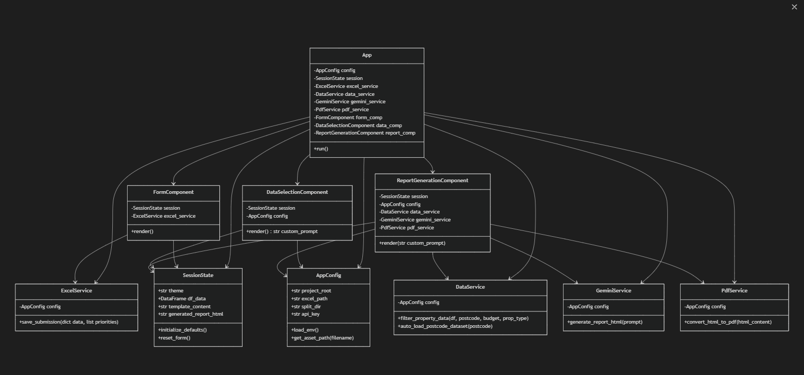
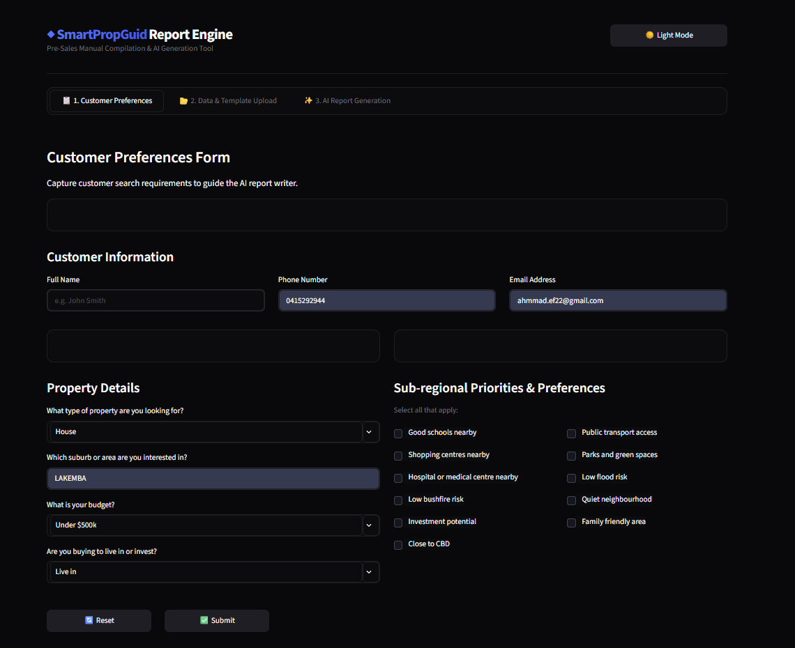
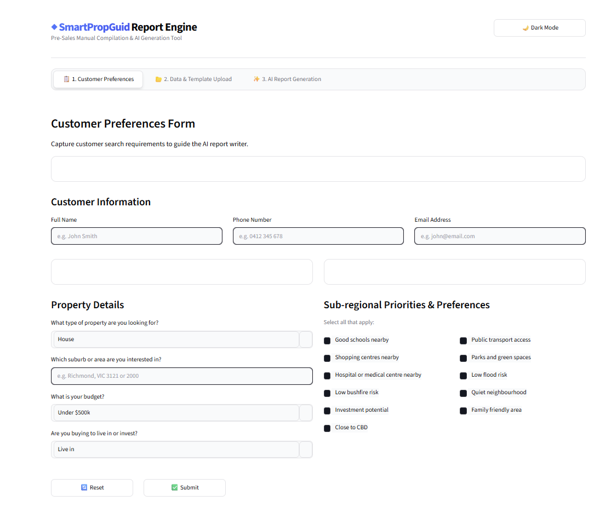

# SmartPropGuide ◆ Report Engine

An enterprise-grade Pre-Sales Manual Compilation & AI Generation tool built with **Python** and **Streamlit**. This repository automates the processing of customer property search requests, handles manual operator data compilation, and utilizes advanced generative AI models to compose beautifully structured, publication-ready real estate evaluation reports.

---

## 🏗️ System Architecture & Workflow

The platform handles the manual collection workflow in a streamlined 3-step pipeline designed for pre-sales operators:

### Architecture Diagram


### Pipeline Steps:

### 📋 1. Customer Preferences Intake
* Captures explicit user property criteria: target location/postcode, property layouts, exact budget distributions, and intention parameters (Owner-Occupier vs. Investor).
* Evaluates secondary priority weights using an interactive grid checklist mapping core environmental and lifestyle metrics (e.g., school boundaries, public transit access, proximity to the CBD, flood and bushfire risks).

### 📂 2. Data Source Configuration
* **Source Data Integration**: Supports both direct manual file uploads (`.csv`, `.xlsx`, `.xls`) and real-time automated data pulling via the **HTAG Suburb Analysis API** (`https://agent.htagai.com/micro-agents/agents/suburb-analysis/execute`).
* **Fixed Report Layout**: Every report renders through the same standard enterprise `sample_template.html` template -- it isn't user-selectable, keeping output consistent across operators.
* **Operational Control Layer**: Provides custom directive text fields for operators to tell the AI model exactly what to prioritize during generation (e.g., target capital growth trajectories or transit vectors).

### ✨ 3. AI Report Generation & Compilation
* Powered by **Anthropic Claude** (model configurable via `CLAUDE_MODEL`, defaults to `claude-sonnet-4-6`).
* Dynamically parses textual data streams, processes structured listings rows, maps scores, and handles real-time HTML string rendering.
* **Graceful Data Fallbacks**: a defensive sanitization pass (`report_sanitizer.py`) guarantees every chart, stat card, and icon-based "What's Nearby" panel renders safely even when the AI or source data leaves a gap -- missing sections show an honest "data unavailable" notice instead of a broken layout or an invented number.
* **Real-Time Generation Feedback**: a full-screen progress overlay tracks the actual pipeline stages (data prep → AI analysis → report assembly → PDF compilation) rather than a generic spinner, so the percentage shown always reflects genuine progress.
* Seamlessly compiles raw HTML code into professional, portable documents using `playwright` for local download.

---

## 📁 Project Structure

The project has been refactored into a modular Object-Oriented design:

```
SmartPropGuid_Report_Gen_Gemini/
├── app.py                      # Main entrypoint & coordinator
├── sample_template.html        # Default report template
├── Cred.env.example            # Template for your own Cred.env (git-ignored, never commit the real one)
├── requirements.txt            # Package dependencies
└── components/                 # Application components and services package
    ├── __init__.py             # Package initializer
    ├── config.py               # AppConfig & SessionState class wrappers
    ├── ui_utils.py             # UI elements helper & CSS styles injection
    ├── submission_store.py     # Customer enquiry log: Google Sheets, or local Excel fallback
    ├── services.py             # DataService, AnthropicService, HtagService, TemplateService, PdfService
    ├── report_sanitizer.py     # Defensive repair of the AI's JSON before it hits the template
    ├── variable_mapper.py      # Standardizes raw HTAG/CSV data into the 41-variable payload
    ├── form.py                 # Customer Preferences form component UI
    ├── data_selection.py       # Data source selection & HTAG API fetcher component UI
    └── report_generation.py    # AI report generator and PDF download component UI
```

Each module has a single responsibility:
- **`App`**: Sets up page properties, custom styling, and routes the navigation tabs to components.
- **`AppConfig`**: Resolves local resources paths, sets environment setups, and loads API keys for Anthropic and HTAG.
- **`SessionState`**: Encapsulates properties in Streamlit state parameters.
- **`UiHelper`**: Renders the stage-driven generation progress overlay and injects the dark/light theme CSS properties.
- **`submission_store`**: Records each customer enquiry (on Generate) to Google Sheets, falling back to the local `SPG_Customer_Intake_Form.xlsx` when no Google credentials are set.
- **`DataService`**: Manages filtering operations and autoloads postcode datasets.
- **`AnthropicService`**: Interacts with Anthropic Claude for structured JSON report generation.
- **`HtagService`**: Connects to the HTAG Micro-Agent Suburb Analysis API to fetch live real estate metrics.
- **`TemplateService`**: Jinja2 rendering engine that safely merges JSON report content into HTML templates.
- **`PdfService`**: Executes a headless browser process to print the HTML report as a high-fidelity PDF.
- **`report_sanitizer`**: Guarantees every field the template touches exists with a safe type and flags materially empty sections, so missing AI data degrades to an honest notice instead of a broken render.

---

## 🎨 Enterprise UI Design System

The application implements a custom dual-theme architecture supporting high-contrast Dark and Light view modes, built on the same navy/gold/cream brand palette extracted from `LOGO.png` and shared with the PDF report itself:
* **Dark Mode**: Deep navy surfaces (matching the report's cover page) with warm cream text and a gold accent.
* **Light Mode**: Warm off-white surfaces with navy text, reconfigured typography, card elements, and form label bindings to lock text colors to rich high-contrast tones, ensuring readability.
* **Layout Isolation**: Default stream headers, toolbars, and branding footprints are isolated via deep CSS injections to deliver a branded interface.
* **Consistent Iconography**: the "What's Nearby" panel and report header use hand-drawn inline SVG icons and the real logo image instead of emoji, so the visual language stays consistent between the web app and the exported PDF.

---

## 🛣️ Development Roadmap

This roadmap outlines the past milestones, current active sprints, and upcoming features for the SmartPropGuide engine.

| Phase | Milestone | Status |
| :--- | :--- | :--- |
| **Phase 1: Foundation** | UI/UX Core Architecture & Frontend Framework | ✅ Done |
| | Integration of Anthropic Claude API Pipeline | ✅ Done |
| | Report Generation PDF Export Module | ✅ Done |
| **Phase 2: Validation** | Backend Data Sync: Excel Intake Form | ✅ Done |
| | OOP Structure Refactoring | ✅ Done |
| | User Acceptance Testing (UAT) | 🚧 Sprinted / Local Verification Pending |
| **Phase 3: Optimization** | Data Reliability & Graceful Fallback Handling | ✅ Done |
| | Brand-Consistent UI & Report Redesign (logo, color palette, icons) | ✅ Done |
| | Real-Time Generation Progress Feedback | ✅ Done |
| | Automated Email Delivery System | ⏳ Pending |

---

## 🚀 Execution & Setup

### Prerequisites
Python 3.11+ and an active Anthropic API key (HTAG and Google Sheets keys are optional -- see below).

> ⚠️ **About the `.venv` folder you get from `git clone`**: this repo tracks a `.venv` in git, but it was built on one specific machine's OS/Python version and will **not** work on a different machine (compiled packages like `cryptography` and `grpcio` are platform-specific). Don't activate it. Create your own virtual environment under a different name, per step 2 below, and leave the tracked one alone.

### Installation
1. Clone the repository:
   ```bash
   git clone https://github.com/Shoyebahmmed/SmartPropGuid_Report_Gen_Gemini.git
   cd SmartPropGuid_Report_Gen_Gemini
   ```
2. Create and activate your OWN virtual environment (named `.venv-local` here specifically so it can't collide with the tracked `.venv` folder from step 1):
   ```bash
   python -m venv .venv-local
   # On Windows (PowerShell):
   .venv-local\Scripts\Activate.ps1
   # On Linux/macOS:
   source .venv-local/bin/activate
   ```
3. Install dependencies:
   ```bash
   pip install -r requirements.txt
   ```
4. Install the browser PDF generation needs (one-time; `pip install` alone does not fetch this):
   ```bash
   playwright install chromium
   ```
5. Set up credentials:
   Copy the template and fill in your own keys -- never someone else's copy of this file, and never commit it:
   ```bash
   cp Cred.env.example Cred.env     # macOS/Linux
   copy Cred.env.example Cred.env   # Windows
   ```
   Then edit `Cred.env` and fill in at least `ANTHROPIC_API_KEY`. See `Cred.env.example` for every variable the app reads (HTAG, Google Sheets, model override) and what each does.
6. Run the application. Use `python -m streamlit`, not a bare `streamlit` command -- on some setups the `streamlit` executable's folder isn't on your PATH even though Python is, which fails with "command not found" despite everything being installed correctly:
   ```bash
   python -m streamlit run app.py
   ```
7. Verify the install before relying on it: fill in the Customer Preferences tab with a real Australian suburb and generate one full report. Confirm it completes, the PDF downloads, and (Tab 2) "Real-data grounding" shows green/ON -- if HTAG is configured correctly, Tab 3's data source will say so too.

### Working with this shared repo

A few rules that cost nothing and prevent real headaches on a repo several people push to:

- **Pull before you start work each session**: `git pull origin main`. The app and its data connections have changed under people's feet before (twice, in the same week) from someone starting on a stale copy.
- **Never commit `Cred.env`, `google_service_account*.json`, or any real key.** They're git-ignored already -- that only works if you don't force-add them.
- **Work on your own branch** for anything beyond a one-line fix: `git checkout -b yourname/short-description`, then open a Pull Request instead of pushing straight to `main`. This gives someone a chance to catch a problem before it reaches everyone else's copy.
- **Never force-push, never run `git reset --hard` / `git clean -fd` on `main`**, and never delete a branch you didn't create. If git has you stuck, ask rather than reaching for a destructive command.

---

## 📸 App Screenshots

### Dark Mode Interface


### Light Mode Interface


